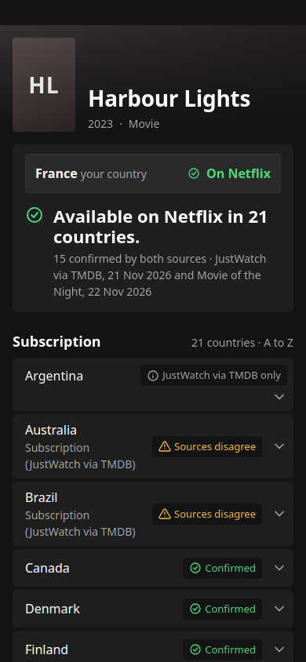
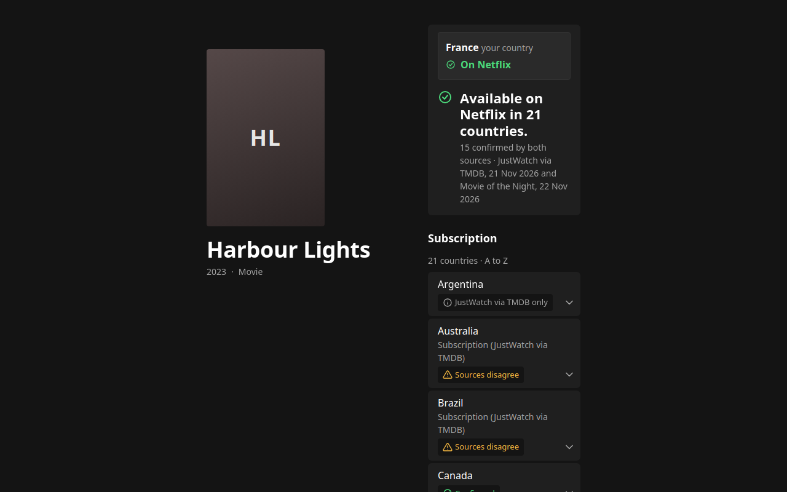

# 🎬 Where to Watch


<br/>

Find where a movie or series is listed for streaming in your country and abroad. Where to Watch is a static web app that you can install on your iPhone or host on your own GitHub Pages site.

<br/>

## 📋 Summary

* [📋 Summary](#-summary)
* [✨ Features](#-features)
* [📸 Screenshots](#-screenshots)
* [🚀 Use it](#-use-it)
* [🏠 Host your own](#-host-your-own)
* [🌍 Coverage and verdicts](#-coverage-and-verdicts)
* [🔒 Privacy](#-privacy)
* [🧪 Develop](#-develop)
* [🤝 Contribute](#-contribute)
* [🛡️ Security](#️-security)
* [🙏 Credits](#-credits)
* [📄 License](#-license)

<br/>

## ✨ Features

* 🔎 Search for movies and series by title.
* 🌍 Check a streaming service across covered countries, with your country shown first.
* 📺 Switch to **All services** to see subscription, free, rental and purchase offers in your country.
* 📱 Add the app to your Home Screen and revisit cached results offline.

<br/>

## 📸 Screenshots

The same availability result at 390 px and 1280 px in dark mode, using fictional data from the app's states page.

<p align="center">
  
  
</p>

<br/>

## 🚀 Use it

1. Open the project owner's instance at `<your-pages-url>` once it is published, or use your own deployment URL.
2. In **Settings → API keys**, add your TMDB **API Read Access Token**. See [Create your API keys](#create-your-api-keys) for setup.
3. Pick your country, search for a movie or series, then select a result and a streaming service.

### Install on iPhone

1. Open the instance in Safari and tap **Share → Add to Home Screen**.
2. Keep **Open as Web App** enabled and tap **Add**.
3. Open the new Home Screen icon and enter your keys in **Settings** again. The installed web app has its own storage.

### Create an iPhone shortcut

1. In **Shortcuts**, create a shortcut named **Where to Watch**.
2. Add **Ask for Input**, choose **Text** and use **Movie or series title?** as the prompt.
3. Add **URL Encode** and pass it the text from **Ask for Input**.
4. Add a **Text** action with `<your-pages-url>/?q=` followed immediately by the **URL Encode** result. Use the full URL, including the repository path, with one slash before the question mark.
5. Add **Open URLs** and pass it the output from **Text**. Run the shortcut, enter a title and choose from the search suggestions.

Use the copy-and-paste recipe if you want to search in the installed app. Keep **Ask for Input** and replace the other actions with **Copy to Clipboard** using the original input. After running the shortcut, open Where to Watch from your Home Screen and paste into the search field. The **Open URLs** recipe can open Safari, where you may need to enter your keys separately.

<br/>

## 🏠 Host your own

### Fork and deploy on GitHub Pages

1. Fork [the repository](https://github.com/sofianehms/wheretowatch) to your GitHub account. Use a fork whose `main` contains the published version and whose visibility is eligible for Pages on your plan.
2. In the fork, open **Actions** and enable workflows if prompted.
3. In **Settings → Pages**, under **Build and deployment**, set **Source** to **GitHub Actions**.
4. Return to **Actions → Deploy to GitHub Pages → Run workflow**, select `main` and click **Run workflow** to start the manual deployment (`workflow_dispatch`).
5. When the deployment succeeds, open the URL from the `github-pages` deployment or **Settings → Pages**. Use that URL in place of `<your-pages-url>`.

### Create your API keys

1. Sign up for a [TMDB account](https://www.themoviedb.org/signup). In [TMDB API settings](https://www.themoviedb.org/settings/api), request developer access and copy the **API Read Access Token**.
2. For an optional second source, follow the sign-up instructions on the [Streaming Availability API page](https://www.movieofthenight.com/about/api). Choose the free plan if it fits your usage and copy your Movie of the Night key.
3. On your deployed instance, paste the token into **TMDB key** and the optional key into **Streaming Availability key** under **Settings → API keys**. Click **Test**, then **Save** for each key you entered. Testing the optional key uses one call from its quota. Choose your country and run a search to check the setup.

Adapt this sample to describe your actual use when a provider asks about the application:

> Where to Watch is my personal, free, open-source, non-commercial project for finding where movies and series are listed for streaming. It displays availability to people who search for a title. The browser calls the provider's API with the user's own key. Repository: https://github.com/YOUR-ACCOUNT/YOUR-FORK

Replace the sample URL with your real repository URL. Review each provider's terms before requesting a key or hosting an instance.

<br/>

## 🌍 Coverage and verdicts

* Coverage varies by title, service, country and source. Series results describe the whole series and can miss season-level differences.
* **Available** means at least one source reports an offer. In a service’s country list, **Confirmed** means both sources list that service in the same country. Offer types can differ, so check each source to see whether it lists a subscription, rental or another offer type. The app flags single-source rows and disagreements where applicable.
* **Not found** means the sources report offers for the title but found none for the selected service in the covered countries. **Not enough data** means the app cannot draw a conclusion. An unrecognized title, an uncovered country or an API error can leave gaps.
* Check the source and retrieval date, especially when using saved results. Country counts are withheld when coverage is unknown. Playback depends on your location and the service's terms. Verify the current offer with the streaming service before subscribing or paying.

<br/>

## 🔒 Privacy

Keys, preferences, cached responses and the usage counter are stored in your browser. The app sends search text to TMDB and title identifiers to the applicable providers. Your browser sends each key to its provider and requests artwork separately. GitHub Pages receives page and file requests, including any title or search in the requested URL. These services may log requests and IP addresses under their own policies.

The app uses no accounts, cookies or analytics. Use **Settings → Clear my data** to remove keys, preferences and cached results from the current browser or installed app. See **About and privacy** in the app for details.

<br/>

## 🧪 Develop

Install Node.js 20 or later and Chrome or Chromium, then run these commands from the repository root:

```console
$ npm ci
$ npm start
```

Open [http://127.0.0.1:8080/](http://127.0.0.1:8080/) for the app and [the title states page](http://127.0.0.1:8080/test/states.html?view=title) for synthetic results. Run the checks in another terminal:

```console
$ npm run lint
$ npm test
$ npm run verify
```

The verification suite captures mobile and desktop screenshots in both themes, runs accessibility and Lighthouse checks, and checks for console errors and horizontal overflow. Set `SHOTS_DIR` to direct captures to another directory. GitHub Actions runs the checks on pull requests to `dev` and `main`.

<br/>

## 🤝 Contribute

[Open an issue](https://github.com/sofianehms/wheretowatch/issues) with steps to reproduce a bug or a description of the change you want to make. Base pull requests on `dev`, follow the existing style and use Conventional Commits. Include the results of the local checks.

<br/>

## 🛡️ Security

Enter API keys in the app's settings on devices you trust. Keys are accessible to scripts running on the same origin. Keep them out of source files, GitHub Actions, screenshots and issue reports. Rotate a key with its provider if it is exposed.

Report a vulnerability through [GitHub Security](https://github.com/sofianehms/wheretowatch/security) if private reporting is available. If it is unavailable, contact the maintainer through their [GitHub profile](https://github.com/sofianehms) before sharing details.

<br/>

## 🙏 Credits

This website uses TMDB and the TMDB APIs but is not endorsed, certified, or otherwise approved by TMDB.

Availability data: JustWatch

Streaming availability information is provided by [Streaming Availability API by Movie of the Night](https://www.movieofthenight.com/about/api)

<br/>

## 📄 License

The code is released under the [MIT License](LICENSE). Data and artwork remain subject to their providers' terms, including the [TMDB API terms](https://www.themoviedb.org/api-terms-of-use), [JustWatch terms](https://www.justwatch.com/us/terms-and-conditions) and [Movie of the Night API terms](https://www.movieofthenight.com/about/api).
